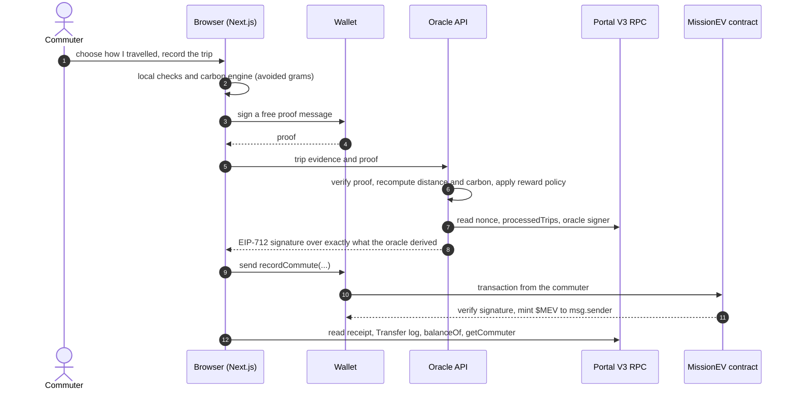

# MissionEV

[](https://github.com/ManavNegi2807/missionev-app/actions/workflows/ci.yml)
[](LICENSE)


**A Strava for carbon.** MissionEV measures the emissions of the journeys people actually make, compares each with a stated reference
journey, and rewards the avoided CO2 with **$MEV** on **Portal V3 (Portaldot) EVM**, through an oracle-signed contract call that the
commuter's own wallet submits. Built for the Portaldot Hacker House 2026.

> **Reward the impact of the journey, not the ownership of the vehicle.** Every trip asks how you travelled. An EV owner in a petrol cab
> earns nothing for that ride; a metro commuter with no vehicle can earn.

## Status at a glance

| | |
|---|---|
| Smart contract | **Live on Portal V3 testnet and verified**: [`0x0904…fc82`](#deployed-on-portal-v3-testnet) |
| Web app | **Live demo: https://missionev-app.vercel.app** (DEMO mode, clearly labelled, no keys on the server). Also runs locally. LIVE needs a server with the oracle key (see [`docs/DEPLOYMENT.md`](docs/DEPLOYMENT.md)) |
| Tests | 100+ passing, including the compiled contract executed in an in-process EVM; CI runs lint, type-check, tests and build |
| Testnet Demo Trip | A **flag-gated, off-by-default** path (`DEMO_SIGNING`) for showing a real testnet transaction without driving: a synthetic trip of at least 1 km that the oracle still re-verifies. Every such trip is labelled, in the app and in history, as not real travel. **Off on the hosted site.** See [DEMO and LIVE](#demo-and-live) |
| Recent on-chain activity | A read-only panel on the landing page: the latest `recordCommute` outcomes read from the contract's event logs (`GET /api/activity`). It shows only what the chain returns, so while no transaction exists it says so |
| Not yet | A first `recordCommute` transaction sent from the web app to the deployed contract. The Demo run was exercised only against a local in-memory chain with the real contract, not against Portal V3 and not with the MetaMask extension |
| Honesty | Sign-in is a MetaMask connection (or a labelled demo account); redemptions are simulated and community analytics are synthetic. See [real versus simulated](docs/INTEGRATION_REPORT.md) |

## For judges: the evidence, by criterion

**Track: Ecosystem DApps** (a consumer-facing application on Portal V3).

| Criterion (weight) | Where to look |
|---|---|
| Technical feasibility (30%) | [Verified testnet deployment](#deployed-on-portal-v3-testnet) with a read-only `npm run contract:verify`; an oracle that recomputes everything before it signs ([`docs/BACKEND.md`](docs/BACKEND.md)); 100+ tests that run the compiled contract in an EVM; CI on every push; a commit history from 30 October ([`git log`](https://github.com/ManavNegi2807/missionev-app/commits/master)) |
| Innovation (30%) | Rewarding the *journey*, not the vehicle; a commuter-submitted EIP-712 flow on Portal V3's EVM layer ([`docs/ARCHITECTURE.md`](docs/ARCHITECTURE.md), [`docs/FLOW.md`](docs/FLOW.md)); an open-source stack end to end (Leaflet and OpenStreetMap, in-browser Tesseract.js OCR) |
| Ecosystem contribution (20%) | MIT-licensed; reusable Portal V3 tooling: a dry-run deploy script, an immutable-aware contract verifier, and `npm run network:health`, which cross-checks the EVM endpoint against the native node (it would have caught the two-day RPC freeze we hit); [builder notes](docs/DEPLOYMENT.md#notes-for-other-builders-on-portal-v3) |
| Business potential (20%) | [`docs/BUSINESS.md`](docs/BUSINESS.md): who pays, revenue paths to test, path to first users, risks |

Pitch deck: [`docs/pitch/MissionEV-pitch-deck.pdf`](docs/pitch/MissionEV-pitch-deck.pdf). Everything the event asks for is mapped in
[`docs/HACKATHON_CHECKLIST.md`](docs/HACKATHON_CHECKLIST.md), including what is still missing.

## Try it in 60 seconds

**No install:** open **https://missionev-app.vercel.app** (it opens on a landing page that explains the idea; press **Launch the app**) and follow the steps below. It is the same app, hosted in DEMO mode: every simulated
result is labelled and nothing on that site holds a key. To run it yourself:

```bash
git clone https://github.com/ManavNegi2807/missionev-app.git
cd missionev-app
npm ci
npm run dev        # http://localhost:3000, DEMO mode, no keys needed
```

On the next screen press **Connect MetaMask**. Your wallet address is your account, and MetaMask offers to add Portal V3 if it is missing. No wallet?
Press **Explore with a demo account**: everything is then simulated and labelled. Choose how you usually commute and save. Open
**Capture trip**, pick **Metro**, choose **Simulated**, press **Start trip**, then **Verify trip**. You get the verification checks, the
carbon comparison with its formula and sources, and an illustrative $MEV preview. The credit button is labelled "not on-chain".

Other commands: `npm test`, `npm run build && npm run start`, `npm run contract:compile`, `npm run dev:chain` (a local in-memory chain
with the real contract, to try the LIVE flow without a network). Needs Node 20.9 or newer.

## The idea

Transport-emissions schemes usually reward who owns a clean vehicle. MissionEV rewards what each journey actually saved: it measures the
trip, compares it with a reference journey over the same distance on the same accounting boundary, and mints a reward for the avoided
grams only if the oracle can verify the evidence. Saved vehicles are only a profile; each trip asks "How did you travel?". EVs are **not**
treated as zero-emission: the electricity they use is counted at the grid's emission factor.

## How it works



1. Capture the trip (real GPS, or a labelled simulation) and choose **how you travelled** for it.
2. Local checks run in the browser; the oracle re-runs them on the evidence it receives.
3. `src/lib/carbon` computes actual emissions and a reference journey, and `co2AvoidedGrams = max(0, floor(reference - actual))`.
4. Your wallet signs a free proof message; `POST /api/sign-trip` (the verifier node) re-verifies, **recalculates itself**, reads your nonce from the
   chain and signs the exact EIP-712 `TripPayload`. The key never leaves the server.
5. Your wallet sends `recordCommute(tripId, mode, distanceMeters, co2AvoidedGrams, deadline, sig)`. The contract credits `msg.sender`, so
   the oracle can sign a trip but can never submit it.
6. The app reads back the receipt, the minted amount (from `Transfer` logs), `balanceOf` and `getCommuter`.

Reward: `20 MEV per kg avoided × streak multiplier (1× / 1.5× / 2× / 3× at 5 / 10 / 20 days) + a mode bonus` paid only when carbon was
avoided. $MEV is a prototype reward token, **not a certified carbon credit**, and it is a different thing from the native tPOT used for gas.
More: [`docs/FLOW.md`](docs/FLOW.md), [`docs/ARCHITECTURE.md`](docs/ARCHITECTURE.md).

## How the credit is calculated

One engine (`src/lib/carbon`) does the same three steps for every mode:

1. **What the journey emitted.** Carbon dioxide comes from burning something. A petrol engine burns fuel (2.232 kg CO₂ per litre; diesel
   2.675). An electric vehicle burns nothing itself, but the power station behind the socket does: India's grid averages **0.6751 kg CO₂ per
   kWh** (CEA, FY 2025-26), so an EV is *not* zero-emission. Its energy use is multiplied by that factor, and a battery-side figure is first
   divided by an assumed 0.9 charging efficiency. Metro is 0.041 kWh per passenger-km and an electric bus about 0.038 (both low-confidence
   placeholders, flagged in the app). Walking and cycling emit nothing at the point of use.
2. **Against a reference journey.** The same distance in an average petrol vehicle: **18 km/l for a car** (124 g CO₂ per km) when you used a
   car-class vehicle (your own car or EV, or a cab), and **50 km/l for a two-wheeler** (45 g per km) when you used no vehicle (metro, bus,
   walking). `avoided = max(0, floor(reference − emitted))`, in whole grams, and a journey that emits more than its reference earns nothing.
3. **Into $MEV**, with the contract's own arithmetic: `20 MEV per kg avoided × streak multiplier (1×, 1.5×, 2×, 3× at 1, 5, 10, 20 days) + a
   mode bonus` (walking or cycling 15, electric car, electric two-wheeler and metro 10, anything else 0). Petrol, diesel and CNG journeys are
   measured but never rewarded; that is MissionEV's rule, enforced by the verifier node before it signs.

Worked example: **10 km, first day of a streak** (the electric car is a sample with a 40.5 kWh battery and 325 km range). A test
([`tests/worked-example.test.ts`](tests/worked-example.test.ts)) pins these figures to the engine.

| Journey | Emitted | Reference | Avoided | $MEV |
|---|---|---|---|---|
| Walk or cycle | 0 g | 446 g (petrol two-wheeler) | 446 g | 23.92 |
| Metro | 277 g | 446 g (petrol two-wheeler) | 169 g | 13.38 |
| Electric bus | 255 g | 446 g (petrol two-wheeler) | 191 g | 3.82 (no bonus) |
| Electric car | 935 g | 1,240 g (petrol car) | 305 g | 16.10 |
| Petrol car | 1,240 g | 1,240 g (petrol car) | 0 g | 0, never rewarded |

What it does **not** count: only energy used while travelling (the "direct energy-use" boundary). Fuel and electricity supply chains,
transmission losses, and building the vehicle or its battery are outside it, and the app says so. The reference vehicles and the metro and
e-bus figures are prototype assumptions, not fleet statistics. And MissionEV counts **people's journeys**, not freight: trucks, delivery
vans and cargo would need payload-based factors (grams per tonne-km), which are not modelled. A ride-hail cab *is* handled, from the vehicle
you confirm and the number of passengers.

## Why Portal V3

* **EVM compatibility.** Standard EIP-712 typed-data signatures, `ecrecover` and an ERC-20 token work unchanged; the app and tests use
  ordinary tooling (viem, solc) and a stock EVM.
* **Commuter-submitted transactions.** The reward goes to `msg.sender`, so users keep control and the oracle never needs funds or custody.
* **State on-chain.** $MEV balances, streaks, carbon score and processed trip ids are public and verifiable.
* **Ecosystem contribution.** Deploy and verify tooling written for this chain's quirks (stale RPC, weight-based fees, a Remix error that
  hides the real result), and notes for other builders in [`docs/DEPLOYMENT.md`](docs/DEPLOYMENT.md#notes-for-other-builders-on-portal-v3).

## Deployed on Portal V3 testnet

| | |
|---|---|
| Network | Portal V3 testnet, chain id `420420777` |
| EVM RPC | `https://test-evm-rpc-v3.portaldot.dev` |
| Native node | `wss://test-node-v3.portaldot.dev` |
| Explorer | [Portaldot node console](https://node-console.portaldot.dev/) |
| Contract | `MissionEVv2` at `0x0904244017324dc1bf7c611fe1236936ee65fc82` |
| Deploy transaction | `0x11562d9b34bc9236413a1d49a7712179d8f50defdc610b3c81c6dbf01d9ca965` (block 309126, 2026-11-03 17:41 UTC) |
| Owner / deployer | `0x184Ef822438f5D64C9dD41F570af794b347CE84e` |
| Oracle signer (the verifier node's address) | `0x2aD67FaC8dB8fF3255bA650639049020420160De` |
| Public proof | [indexer record of the deploy transaction](https://portalindex-98f0.onrender.com/evm_transactions?tx_hash=eq.0x11562d9b34bc9236413a1d49a7712179d8f50defdc610b3c81c6dbf01d9ca965) |

The deployed contract is the fixed v2 in [`contracts/proposed/MissionEVv2.sol`](contracts/proposed/MissionEVv2.sol) (see the audit for what
changed from the supplied v1). Check it yourself, read-only:

```bash
PORTAL_RPC_URL=https://test-evm-rpc-v3.portaldot.dev npm run contract:verify -- \
  --address 0x0904244017324dc1bf7c611fe1236936ee65fc82 \
  --oracle 0x2aD67FaC8dB8fF3255bA650639049020420160De --owner 0x184Ef822438f5D64C9dD41F570af794b347CE84e
```

It reads the code from the chain and compares it with the compiled artifact (apart from the `DOMAIN_SEPARATOR` immutable, which the chain
fills in), recomputes the EIP-712 domain separator for this chain and address, and checks the token name, oracle and owner. The deploy
record is in [`contracts/deployments/`](contracts/deployments/). **Status as of this commit:** the contract is live and verified, but no
`recordCommute` transaction has been sent to it yet, and the web app runs in DEMO until a server is given the oracle key. The owner can
replace the oracle signer, so the owner key matters as much as the oracle key. Details: [`docs/SMART_CONTRACT.md`](docs/SMART_CONTRACT.md).

You can also watch it answer without installing anything: the landing page's **Ask the chain, right now** panel (and `GET /api/chain`) reads
the real testnet live. It shows the newest block and its age, the contract's code size, the token, the $MEV supply, the oracle signer, the
owner and the EIP-712 domain check. It is read-only, needs no wallet or key, and says plainly when the public RPC is not answering.

## DEMO and LIVE

The app is **DEMO** (everything labelled, nothing on-chain) until the server has `MISSIONEV_CONTRACT_ADDRESS`, `PORTAL_RPC_URL` and
`ORACLE_PRIVATE_KEY`. A journey is **LIVE** only if it was captured with real GPS, the server is configured, and a real wallet is
connected on Portal V3 (chain 420420777). A DEMO result is never presented as an on-chain transaction. `GET /api/status` shows what is
configured, never the secrets.

**Simulated trips are never signed, with one flag-gated exception: the Testnet Demo Trip.** It exists so a reviewer or a demo video can
show a real testnet transaction without driving. It is **off by default** and meant for a *separate* demo deployment, not the main site:

* The server flag `DEMO_SIGNING=true` is the authority. `NEXT_PUBLIC_DEMO_SIGNING=true` only makes the interface offer the button.
* It needs a real wallet on Portal V3 and the same fresh wallet proof as any trip. The no-wallet demo account can never reach the chain.
* The oracle still recomputes distance and CO2 itself from the samples, needs at least 1 km, applies the same reward policy (petrol,
  diesel and CNG are never signed), the same rate limits and daily cap, plus a per-wallet demo cap (`DEMO_MAX_TRIPS_PER_WALLET`, default 3 a day).
* The trip id is derived from a `missionev-demo:` prefix, so the oracle can tell demo trips apart off-chain, and it stays an ordinary
  `bytes32` the contract's `processedTrips` guard handles. The response carries `demo: true`.
* In the app it is the **Demo run (1 km+)** card on Screen 02: pick a mode, press the button, and a synthetic trip stops itself at about
  1.2 km and verifies itself. One more button asks the oracle and your wallet to record it. It is labelled **TESTNET DEMO TRIP: synthetic
  distance, not GPS-verified. The transaction is real; the trip is not.** and shows as **DEMO · ON-CHAIN** in trip history.

The on-chain record cannot tell a demo trip from a real one, so the on-chain activity panel says so too.

## Features

| Area | What it does |
|---|---|
| Landing page | A public front door at `/`: an interactive hero (mouse-reactive network, tilting card, parallax), a "try the maths" calculator that runs the real engine, and an honest real-versus-simulated summary |
| Sign-in | **Connect MetaMask**: the wallet address is the account, with network switching, account switching and a Portal V3 add-network prompt. No phone number or password; a labelled demo account exists for visitors without a wallet |
| Live chain proof | The landing page's **Ask the chain, right now** panel and `GET /api/chain` read the real Portal V3 testnet and the deployed contract (newest block, code, token, $MEV supply, oracle, owner, EIP-712 domain) with no wallet or key, and say so when the public RPC is down |
| Transport profile | Nine journey modes plus an "other" that is not calculated, multi-vehicle; EV efficiency from battery and range or kWh per 100 km; petrol and diesel from km per litre; honest "don't know" fallbacks with confidence labels |
| Per-trip mode | Every trip asks how you travelled; a petrol cab is measured as a petrol cab even if you own an EV |
| Carbon engine | One accounting boundary for all modes, sourced factors (CEA grid factor, FY 2016-17 to 2025-26), formulas with substituted inputs, confidence and assumptions |
| Verifier node | `POST /api/sign-trip`: re-verifies the evidence, calculates the CO2 avoided itself, applies the reward policy, reads the nonce from the chain, signs the exact EIP-712 payload |
| Verification engine | Four checks (vehicle profile, ride log, motion, route) then a trust level |
| Ride-hail | Receipt text read by Tesseract.js in the browser (the image never leaves the device), electric vehicles flagged, with the commuter confirming the vehicle |
| Rewards | Exact preview of the contract's arithmetic, real `balanceOf` read-back, separate tPOT gas balance, labelled simulated redemptions |
| Analytics | ESG dashboards, journey table, leaderboard, definitions and data sources |
| Tooling | Dry-run deploy script, read-only verifier, a local in-memory chain, an audit of the supplied contract |

## Tech stack

Open-source stack: Next.js 16 (App Router, Cache Components) with the verifier node as route handlers, React 19, Tailwind v4, TypeScript,
viem, recharts, **Leaflet + OpenStreetMap** for the map (an optional Google key can override it), **Tesseract.js** for receipt OCR,
Solidity 0.8 compiled with solc-js 0.8.34, vitest with `@ethereumjs/vm`. Full list with licences: [`THIRD_PARTY.md`](THIRD_PARTY.md).

## Repository map

| Path | Contents |
|---|---|
| `src/app/page.tsx`, `src/components/landing/` | The public landing page at `/` (interactive hero, real-engine calculator) |
| `src/app/(app)/` | The four screens: register, capture-trip, rewards, analytics |
| `src/app/api/` | Route handlers: oracle, trip calculate and verify, OCR, status, read-only chain reads |
| `src/server/` | Oracle logic: config, signing service, chain reader, rate limiting |
| `src/lib/carbon/` | Emission factors, efficiency, the journey engine, contract mapping, reward policy and preview |
| `src/lib/oracle/`, `src/lib/contract/` | EIP-712 payload, wallet proof, ABI and chain constants |
| `src/providers/`, `src/components/` | App state and UI |
| `contracts/` | `MissionEV.sol` (as supplied, minus one header comment line), `proposed/MissionEVv2.sol` (deployed), compiled artifacts, deployment record |
| `scripts/` | `compile-contract`, `deploy-contract`, `verify-deployment`, `network-health`, `dev-chain` |
| `tests/` | 100+ vitest tests: carbon, contract, oracle, transport, routes, receipt OCR, network health |
| `e2e/` | Browser tests with playwright-core: landing page, wallet sign-in, demo flow (`npm run e2e`) |
| `docs/` | Architecture, flow, frontend, backend, contract, deployment, audit, integration report, demo script, checklist |

## Environment variables

Copy `.env.example` to `.env.local`. It already holds the public values of the deployment (contract address, RPC URL, tPOT symbol); every
secret is blank. **Server-only** (never `NEXT_PUBLIC_`): `ORACLE_PRIVATE_KEY`, `MISSIONEV_CONTRACT_ADDRESS`, `PORTAL_RPC_URL`,
`ORACLE_SIGNATURE_TTL_SECONDS`, `ORACLE_MAX_TRIPS_PER_DAY`, `DEMO_SIGNING`, `DEMO_MAX_TRIPS_PER_WALLET` (the last two default to off and 3). **Public:** `NEXT_PUBLIC_MEV_CONTRACT_ADDRESS`, `NEXT_PUBLIC_PORTAL_RPC_URL`,
`NEXT_PUBLIC_PORTAL_CURRENCY_SYMBOL`, `NEXT_PUBLIC_PORTAL_EXPLORER_URL`, `NEXT_PUBLIC_DEMO_SIGNING` (a label only; it grants nothing), and the optional `NEXT_PUBLIC_GOOGLE_MAPS_KEY` (visible to every
visitor: restrict it by domain). Receipt OCR needs no setting. Use a **fresh** oracle key whose address is the contract's oracle signer.

## Testing

```bash
npm test           # the full suite
npm run lint && npm run typecheck && npm run build
npm run dev        # then, in another terminal:
npm run e2e        # the browser tests (Chrome or Edge, nothing downloaded): landing page, wallet sign-in, demo flow
```

The contract tests compile the contract and execute it in an in-process EVM (`@ethereumjs/vm`), so every audit finding is demonstrated by
running code, and the app's EIP-712 typed data and reward preview are checked against the contract's own `DOMAIN_SEPARATOR` and arithmetic.
The full flow (sign-in, nine journey modes, EV, petrol and cab trips, rewards, analytics) was also driven in a real browser in DEMO mode, and the
LIVE flow against a local chain, with a mock wallet. The landing page, wallet sign-in and demo-flow browser tests are in [`e2e/`](e2e/README.md)
so anyone can re-run them (138 checks); the local-chain LIVE, receipt-scan and screen-size scripts have not been moved into the repo yet.

<details>
<summary><strong>Carbon accounting (<code>src/lib/carbon</code>)</strong></summary>

One engine, one boundary: **direct energy-use emissions**: fuel burnt in the vehicle (petrol, diesel, CNG) and fuel burnt at the power
station for electricity (EVs, metro, e-bus). EVs are *not* zero-emission here: kWh drawn × the grid factor. Battery-side consumption is
grossed up by an assumed charging efficiency; transmission losses, fuel and electricity supply chains and vehicle or battery manufacturing
are outside the boundary, and the UI says so.

* `emissionFactors.ts`: every factor with value, unit, year, geography, method, source, status (`primary`, `secondary`, `assumption`) and confidence.
  Electricity: CEA CO2 Baseline Database v22.0, national weighted-average grid rate, FY 2025-26 = 0.6751 kgCO2/kWh (not a CDM margin).
* `emissionsEngine.ts`: `calculateJourney()` returns the result, formulas with substituted inputs, factors, assumptions, confidence, contract mode and eligibility.
* `efficiency.ts`: EV kWh per km from battery ÷ range (40.5 kWh / 325 km = 0.1246 kWh/km = 12.46 kWh/100 km), per-100-km or km/kWh inputs, validation bounds.
* `contractMapping.ts`: the contract's `TransportMode` numbers (never reordered). No mode exists for petrol two-wheelers, CNG or unknown vehicles, so they are calculated off-chain only.
* `rewardPolicy.ts`: MissionEV's own rule (the contract enforces none of it): petrol, diesel and CNG journeys and zero-saving journeys are never signed.
* `rewardPreview.ts`: an integer-exact replica of the contract's reward arithmetic, tested against the compiled contract.

Efficiency is a supporting metric: a bigger battery or longer range is **not** more efficient; only lower kWh/km is. There is no invented
efficiency multiplier, because the contract has none.
</details>

<details>
<summary><strong>Data and privacy rules</strong></summary>

No phone number, name or e-mail is collected (the account is a wallet address, or a labelled demo account); no raw GPS paths persisted (coordinates rounded to about 110 m; samples go to the oracle only
for the request and are not stored); no wallet addresses or vehicle identifiers in analytics exports; registration numbers kept only
masked; receipt images never stored; mock data stays labelled DEMO.
</details>

<details>
<summary><strong>Maps and theme</strong></summary>

The map is **Leaflet on OpenStreetMap tiles**: no key, dark-mode tiles when the theme is dark, and a green route and trail. A Google Maps
key (`NEXT_PUBLIC_GOOGLE_MAPS_KEY`) overrides it if you set one. A provider that fails at runtime hands over to the next; a labelled
offline demo map is the last resort. A metro layer is on by default for metro trips. Colours are CSS variables in `src/app/globals.css` (light by default, `:root[data-theme="dark"]`
overrides); charts and the map read the variables.
</details>

## Known limitations

* Sign-in is a wallet connection, not yet a signed login message: the app keeps the address MetaMask shares for the life of the browser tab
  and issues no server session. What matters on-chain does not rely on it: the verifier node re-checks a fresh wallet signature on every
  reward request. A demo account has no wallet and nothing it does is on-chain.
* The oracle's daily limit and duplicate memory are in process memory (reset on restart, per instance); the on-chain `processedTrips` flag is
  the durable guard. A durable store is the next step.
* Receipt OCR (Tesseract.js) was tried on rendered sample receipts, not real Ola, Uber or Rapido screenshots, so accuracy on real ones is
  unproven. The first scan downloads the OCR engine from a public CDN, so it needs a connection once.
* Metro, e-bus, CNG and the reference-vehicle factors are low-confidence placeholders and are flagged as such in the UI; the vehicle model
  catalogue has names only, no efficiency figures.
* The contract has no `redeem` or `burn`, so redemptions are a labelled simulation, and community analytics data is synthetic.
* One oracle key signs rewards, and the owner can replace it; GPS comes from the commuter's own browser and can be spoofed.
* The web app has been driven with a mock wallet, not yet with MetaMask against the deployed contract. The verifier node's signature has been
  accepted by the deployed contract in a simulation (nothing sent), but no real `recordCommute` transaction exists yet.
* **Testnet demo trips are not real travel.** Where `DEMO_SIGNING` is on, a wallet can record a synthetic trip on-chain; the transaction is
  real and the journey is not. The contract cannot tell the difference, so anything that counts on-chain activity should read this
  README first. The hosted site keeps the flag off. A per-wallet cap and the daily cap limit abuse but are in process memory, so a
  restart forgets them; an attacker with many wallets is bounded only by the oracle wallet's and the contract's own limits.
* The Demo run and the activity panel were verified with a mock wallet against a local in-memory chain running the real contract (and the
  panel's reader against the public RPC's shape through fakes). Neither has been run against Portal V3 or with the MetaMask extension.
* The activity panel scans the event logs in block windows and retries with smaller ones if the public RPC caps the range. If the RPC
  refuses all of them it says so instead of showing rows.
* A `recordCommute` call is estimated at about 35 tPOT on the testnet at the gas price seen on 4 November, paid by the commuter's wallet. Real
  users would need sponsored gas, batching or a fee rebate (see [`docs/BUSINESS.md`](docs/BUSINESS.md)).

## Hackathon period and disclosure

* **History.** The repository starts on 30 October 2026 (a create-next-app scaffold, then a first front-end commit with mocked data) and
  carries on with small, logical commits to 3 November 2026; see `git log`. Nothing was back-dated.
* **Added after the first front-end commit:** the journey-based carbon engine, transport profile, oracle service and EIP-712 flow, the
  contract integration and audit, tests, deploy and verify tooling, the testnet deployment, and the documentation.
* **Supplied or carried over:** `contracts/MissionEV.sol` was supplied as the project's contract and is unchanged apart from one comment line removed from its header; the reference-journey
  constants (petrol car 18 km/l, petrol two-wheeler 50 km/l) were carried over from an earlier prototype.
* **Simulated or mocked:** demo accounts, community analytics, redemptions, and any trip captured in Simulated mode, including a flag-gated
  testnet demo trip. Each is labelled in the UI.
* **Changed close to the freeze (5 November 2026, before the 6 November 04:00 UTC code freeze).** A flag-gated Testnet Demo Trip path, a
  read-only recent-activity panel, and copy fixes. The demo path is off by default and off on the hosted site, so the submitted behaviour
  is unchanged unless the owner turns it on. Details and commits: [`docs/HACKATHON_CHECKLIST.md`](docs/HACKATHON_CHECKLIST.md).
* **Third-party code, data and services:** [`THIRD_PARTY.md`](THIRD_PARTY.md).
* **AI assistance.** Much of the work after the first front-end commit was written with Claude Code, Anthropic's coding agent, working in
  this repository under the developer's direction (commits carry a `Co-Authored-By` trailer). The contract deployment was run by the
  developer on their own machine with their own keys. The 5 November additions above were also written with Claude Code, from a written
  brief by the developer, and tested with the commands in [Testing](#testing); the developer reviews them before relying on them.

## Roadmap

A durable verifier-node store (a database), Sign-In with Ethereum (a signed login message and a server session), sourced metro and e-bus factors and vehicle efficiency data,
a redeemable partner catalogue, and a hosted demo. A transit operator or employer pilot is the commercial path.

## Team and licence

Manav Negi ([@ManavNegi2807](https://github.com/ManavNegi2807)). Add teammates and roles here before submitting.

[MIT](LICENSE). Security notes: [`SECURITY.md`](SECURITY.md). Contributing: [`CONTRIBUTING.md`](CONTRIBUTING.md).
