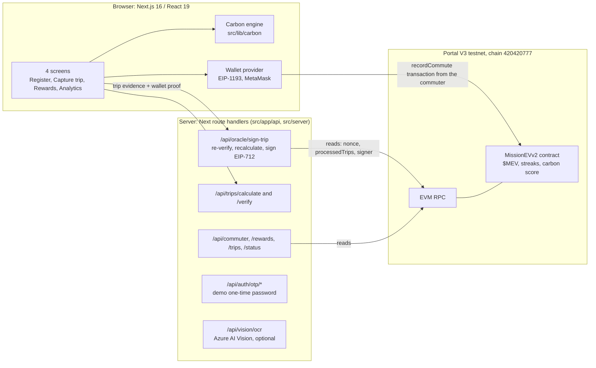
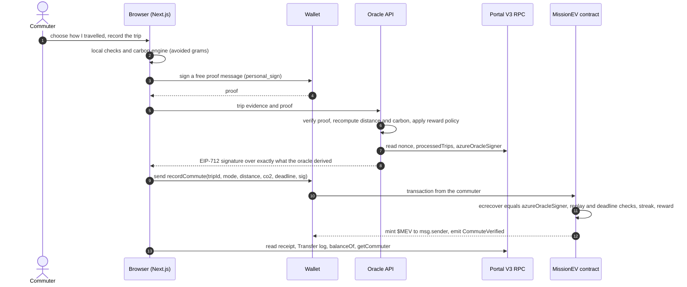

# Architecture

MissionEV has three layers: a Next.js app in the browser, a thin server (Next.js route handlers) that acts as the trusted **oracle**, and
the **MissionEV contract** on Portal V3. The browser never holds a signing key for rewards; the server never submits a transaction.

## Journey to $MEV

## Trust boundaries

| Who | Can do | Cannot do |
|---|---|---|
| Commuter's browser | Capture a trip, run the carbon engine, ask for a signature, submit the transaction with their own wallet | Choose the numbers that get signed: the oracle recomputes them |
| Oracle (server) | Sign a `TripPayload` it derived itself, only for a commuter who proved wallet ownership | Submit a transaction (the contract credits `msg.sender`), or sign for a key other than the contract's `azureOracleSigner` |
| Contract | Verify the signature, block replays and expired signatures, mint, keep streak and score | Check that the journey really happened: it trusts the oracle |
| Owner (deployer) | Replace the oracle with `setAzureOracle` | Mint directly, pause, or change balances |

What the oracle checks before it signs is listed in [`FLOW.md`](FLOW.md) and implemented in `src/server/signService.ts`.

## Where the "Azure Functions" layer lives

The design calls for an Azure-style oracle service. Here it is implemented as Next.js route handlers (`src/app/api/**`), which are plain
`Request` to `Response` functions with the logic in `src/server/*` and `src/lib/*`. Moving them to Azure Functions would need only a thin
wrapper. No Azure Function, Cosmos DB, Azure Maps routing or Power BI is deployed or called; Azure AI Vision is used only if configured.

## Code map

| Concern | Path |
|---|---|
| Screens | `src/app/(app)/*`, `src/components/*` |
| App state and settlement flow | `src/providers/` (onboarding, wallet, trip, rewards) |
| Carbon accounting and reward preview | `src/lib/carbon/` |
| EIP-712 typed data, wallet proof, signing | `src/lib/oracle/`, `src/server/` |
| Contract ABI and chain constants | `src/lib/contract/`, `src/lib/chain.ts` |
| Contract source, artifacts, deployment record | `contracts/` |
| Deploy, verify and local-chain tooling | `scripts/` |
| Tests | `tests/` |

## Known architectural limits

The oracle's rate limit and duplicate memory live in process memory, so they reset on restart and are per instance (on a serverless host
each instance has its own). The on-chain `processedTrips` flag is the durable duplicate guard. A durable store is the obvious next step.
