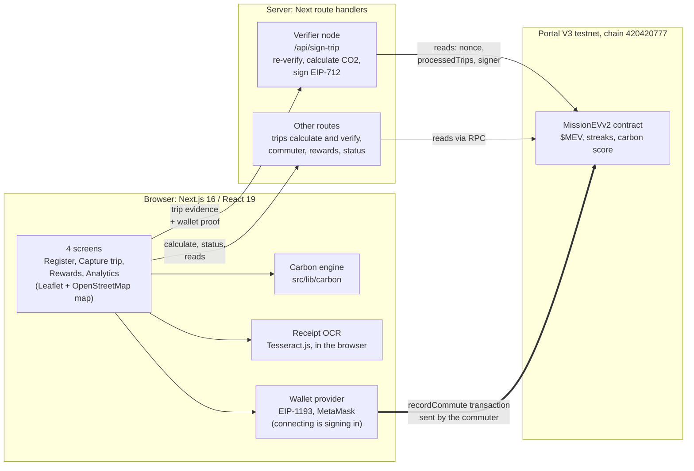
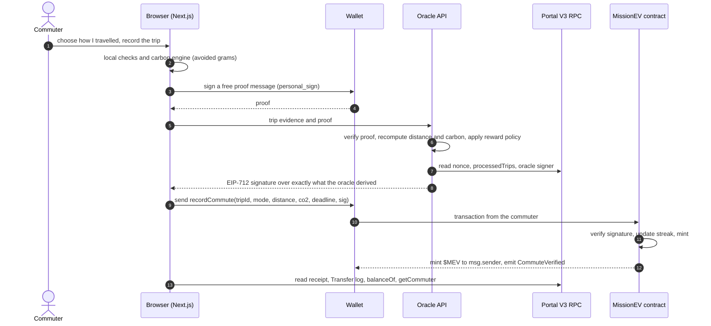

# Architecture

MissionEV has three layers: a Next.js app in the browser, a thin server (Next.js route handlers) that acts as the trusted **oracle**, and
the **MissionEV contract** on Portal V3. The browser never holds a signing key for rewards; the server never submits a transaction.

The thick arrow is the point of the design: the server only signs and reads. The commuter's own wallet sends the transaction.

## Journey to $MEV

## Trust boundaries

| Who | Can do | Cannot do |
|---|---|---|
| Commuter's browser | Capture a trip, run the carbon engine, ask for a signature, submit the transaction with their own wallet | Choose the numbers that get signed: the oracle recomputes them |
| Oracle (server) | Sign a `TripPayload` it derived itself, only for a commuter who proved wallet ownership | Submit a transaction (the contract credits `msg.sender`), or sign with a key other than the contract's oracle signer |
| Contract | Verify the signature, block replays and expired signatures, mint, keep streak and score | Check that the journey really happened: it trusts the oracle |
| Owner (deployer) | Replace the oracle signer (an owner-only function) | Mint directly, pause, or change balances |

What the oracle checks before it signs is listed in [`FLOW.md`](FLOW.md) and implemented in `src/server/signService.ts`.

## Where the verifier node lives

The verifier node (the oracle signer) is a set of Next.js route handlers (`src/app/api/**`): plain `Request` to `Response` functions with the
logic in `src/server/*` and `src/lib/*`, so it runs on any Node host. The whole stack is open source: the map is Leaflet on OpenStreetMap
tiles, receipt OCR is Tesseract.js running in the browser, and the carbon engine and signing are plain TypeScript with viem. No hosted
function platform, managed database or paid OCR, maps or routing service is called.

## Code map

| Concern | Path |
|---|---|
| Screens | `src/app/(app)/*`, `src/components/*` |
| App state and settlement flow | `src/providers/` (onboarding, wallet, trip, rewards) |
| Carbon accounting and reward preview | `src/lib/carbon/` |
| EIP-712 typed data, wallet proof, signing | `src/lib/oracle/`, `src/server/` |
| Contract ABI and chain constants | `src/lib/contract/`, `src/lib/chain.ts` |
| Contract source, artifacts, deployment record | `contracts/` |
| Deploy, verify and local-chain tooling | `scripts/` |
| Tests | `tests/` |

## Known architectural limits

The verifier node's rate limit and duplicate memory live in process memory, so they reset on restart and are per instance (on a serverless host
each instance has its own). The on-chain `processedTrips` flag is the durable duplicate guard. A durable store is the obvious next step.
