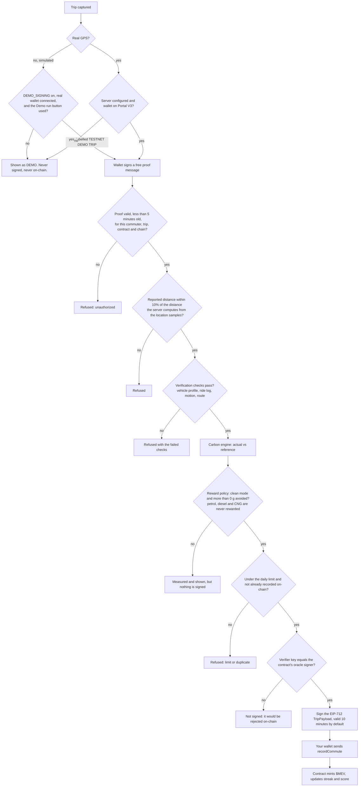

# How a trip becomes $MEV

In plain language, with the exact rules the code applies.

1. **Say how you travelled.** Every trip starts with "How did you travel for this journey?" (private EV, petrol or diesel car, two-wheeler,
   Ola/Uber/Rapido, metro, electric bus, walking or cycling). Saved vehicles are only a profile: an EV owner who takes a petrol cab is
   measured as a petrol cab.
2. **Record the trip.** Real GPS from the browser, or a clearly labelled simulation for demos. (Where the owner has turned on
   `DEMO_SIGNING`, a connected wallet can also run a **Testnet Demo Trip**: a synthetic trip of at least 1 km. Steps 3 to 5 then apply
   unchanged, but the trip is labelled *not real travel* everywhere.)
3. **Measure.** The carbon engine computes the journey's emissions, the emissions of a stated *reference journey* over the same distance,
   and `co2AvoidedGrams = max(0, floor(reference - actual))`. EVs are not treated as zero: the grid factor applies to the electricity used.
4. **Ask the oracle.** Your wallet signs a free proof message; the server checks it, **recomputes everything itself** and decides.
5. **Record on-chain.** If the oracle signs, your own wallet sends `recordCommute`. The contract checks the signature and mints $MEV to you.

## What the reward is

`reward = 20 MEV per kg avoided × streak multiplier + mode bonus`

| Streak (consecutive UTC days) | Multiplier |
|---|---|
| 1 to 4 | 1× |
| 5 to 9 | 1.5× |
| 10 to 19 | 2× |
| 20 or more | 3× |

Mode bonus, paid only when more than 0 g was avoided: +15 MEV for walking or cycling, +10 MEV for an EV car, an electric two-wheeler or the
metro. Electric buses get none. Example: a metro trip that avoids 1.5 kg on day 1 earns 1.5 × 20 = 30 MEV, plus 10 = **40 MEV**.

The app shows this as an **illustrative preview** before anything is recorded. The preview is an integer-exact replica of the contract's
arithmetic and is tested against the compiled contract. $MEV is a prototype reward token, **not a certified carbon credit**.

## DEMO and LIVE

| | DEMO | LIVE |
|---|---|---|
| Needs | Nothing | Real GPS, a server with contract address, RPC URL and oracle key, and a real wallet on chain 420420777 |
| Trip source | Simulated or real | Real GPS only (or, only where `DEMO_SIGNING` is on, a labelled synthetic demo trip of at least 1 km) |
| Result | Credited in the browser tab only, labelled "not on-chain" | A real transaction, with receipt, minted amount and balance read back |

`GET /api/status` shows which settings the server has (never the secrets).
